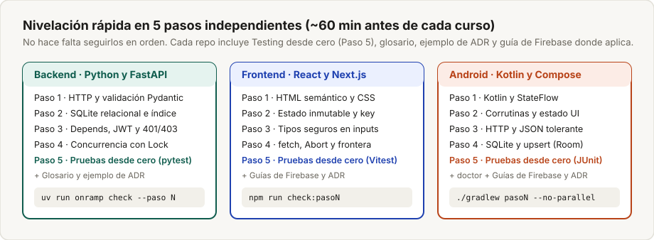

# Repositorios On-Ramp — Nivelación rápida antes de cada curso

Este índice reúne los tres repositorios de práctica corta (**~60 minutos cada uno**) pensados para cualquier estudiante que diga *"no entiendo"* o *"el curso está muy avanzado"* antes de entrar a **Backend (FastAPI)**, **Frontend (React y Next.js)** o **Android (Kotlin y Jetpack Compose)**.

Cada repositorio se organiza en **pasos independientes** con diagramas, explicación clara, glosario de términos con enlaces oficiales, pruebas automáticas y un repositorio de solución donde queda detallado qué se cambió en cada paso.

---

## Mapa rápido de repositorios

| Área | Duración | Repositorio de práctica (empieza aquí) | Solución explicada paso a paso | Repositorio del curso |
| :--- | :---: | :--- | :--- | :--- |
| **Backend (Python y FastAPI)** | ~60 min | [ykro/backend-onramp](https://github.com/ykro/backend-onramp) | [ykro/backend-onramp-solution](https://github.com/ykro/backend-onramp-solution) | [ykro/backend-course](https://github.com/ykro/backend-course) |
| **Frontend (React y Next.js)** | ~60 min | [ykro/frontend-onramp](https://github.com/ykro/frontend-onramp) | [ykro/frontend-onramp-solution](https://github.com/ykro/frontend-onramp-solution) | [ykro/frontend-course](https://github.com/ykro/frontend-course) |
| **Android (Kotlin y Compose)** | ~60 min | [ykro/android-onramp](https://github.com/ykro/android-onramp) | [ykro/android-onramp-solution](https://github.com/ykro/android-onramp-solution) | [ykro/android-course](https://github.com/ykro/android-course) |

---

## Qué practicas en cada uno

### 1. Backend — [ykro/backend-onramp](https://github.com/ykro/backend-onramp)
- **Paso 1 (20 min):** peticiones y respuestas HTTP (`201`, `204`, `404`, `422`), validación con Pydantic (`extra="forbid"`, `Decimal`) y aislamiento de estado entre peticiones.
- **Paso 2 (20 min):** tu primera base de datos en SQLite puro (`PRAGMA foreign_keys = ON`, tablas con llave primaria y foránea, `INSERT`, `INNER JOIN`, `ORDER BY ... LIMIT/OFFSET` con parámetros `?` e índice verificado con `EXPLAIN QUERY PLAN`).
- **Paso 3 (20 min):** `Depends` y `dependency_overrides` para pruebas aisladas, lectura de un JWT (Base64Url) separando `401` de `403`, y protección contra llamadas simultáneas con `threading.Lock`.
- **Verificación:** `uv run onramp check` (12 pruebas automáticas).
- **Solución paso a paso:** [ykro/backend-onramp-solution](https://github.com/ykro/backend-onramp-solution).

### 2. Frontend — [ykro/frontend-onramp](https://github.com/ykro/frontend-onramp)
- **Paso 1 (20 min):** pasar de `
`s a HTML semántico operable con teclado (`<label>`, `aria-invalid`, `aria-describedby`, roles accesibles de Testing Library) más Flexbox, CSS Grid y `:focus-visible`.
- **Paso 2 (20 min):** por qué mutar un arreglo con `.push()` congela React (`Object.is`), por qué `key={index}` desordena inputs al filtrar y cómo convertir entradas de formulario sin mentirle a TypeScript con `as number`.
- **Paso 3 (20 min):** revisar `response.ok` ante respuestas HTTP 404, cancelar búsquedas lentas con `AbortController` y separar componentes `"use client"` de secretos de servidor.
- **Verificación:** `npm run check` (9 pruebas automáticas y chequeo estricto de TypeScript) + `npm run dev` para probar los 3 pasos en el navegador.
- **Solución paso a paso:** [ykro/frontend-onramp-solution](https://github.com/ykro/frontend-onramp-solution).

### 3. Android — [ykro/android-onramp](https://github.com/ykro/android-onramp)
- **Paso 0 (10 min):** `./gradlew doctor --no-parallel` verifica JDK 21+ y `ANDROID_HOME` antes de empezar.
- **Paso 1 (15 min):** lambdas como último parámetro y funciones con receptor (para entender `Column { Text(...) }` y `module { single { ... } }`), `sealed interface` y por qué mutar una `MutableList` impide que `StateFlow` avise a la pantalla.
- **Paso 2 (15 min):** `suspend` y `delay` probados con reloj virtual (`runTest` + Turbine), no atrapar `CancellationException` y conservar estado entre redibujos (`remember`).
- **Paso 3 (20 min):** lectura tolerante de JSON contra `MockWebServer` y tu primera tabla SQLite (`CREATE TABLE`, `PRIMARY KEY`, `SELECT ... WHERE ... ORDER BY` y `ON CONFLICT DO UPDATE` en lugar de `INSERT OR REPLACE` para no borrar favoritos locales).
- **Verificación:** `./gradlew ready --no-parallel` (11 pruebas sin necesidad de encender un emulador).
- **Solución paso a paso:** [ykro/android-onramp-solution](https://github.com/ykro/android-onramp-solution).

---

## Cómo trabajar con IA en estos repositorios

Puedes usar tu asistente de IA favorito (Claude Code, Antigravity, Codex o Gemini CLI) mientras resuelves los pasos. Cada repositorio trae un archivo `AGENTS.md` configurado en **modo tutor socrático**: te explica los conceptos, te da pistas paso a paso y te ayuda a interpretar los errores de consola sin quitarte el aprendizaje.

Cuando quieras contrastar tu resultado o te quedes atascado en un paso puntual, abre el repositorio `*-solution` correspondiente: su `README.md` tiene la tabla **Dónde ver la solución de cada paso**, con el criterio exacto, qué se cambió y el enlace directo al archivo resuelto.
